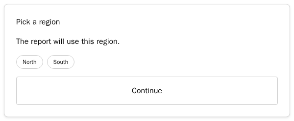
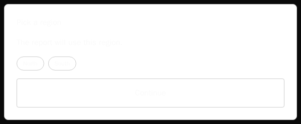
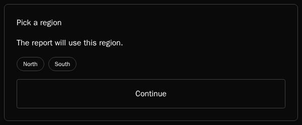

# CopilotKit chat UI: labels, accessible names and A2UI dark mode

Minimal reproduction for three issues in CopilotKit's prebuilt v2 chat, `@copilotkit/react-core` and `@copilotkit/vue` 1.79.1:

1. **Strings outside `labels`.** Some strings stay in English whatever the app passes: the reasoning header's "Thinking…" and "Thought for …", the slash-command menu, and several screen-reader labels.
2. **Unnamed buttons.** Some icon-only buttons have no accessible name. In React these are send/stop, add, voice, scroll-to-bottom and branch navigation. In Vue, scroll-to-bottom has no name and the stop button is announced "Send message".
3. **A2UI dark mode.** The A2UI basic catalog card stays white in dark mode while its text turns light.

The page renders the chat view with static messages:
- a reasoning block and a reply;
- an A2UI card with a chip-style `ChoicePicker` and a `Button`;
- a queued video attachment and a tools menu;
- a second chat whose reasoning is still streaming.

There is no agent and no LLM. The provider requires a runtime URL; it points at a same-origin path that doesn't exist, so the only request is a local 404.

- `?theme=dark` puts `class="dark"` on `<html>`, the documented way to switch the chat to dark.
- `?lang=de` passes German strings through `labels`, including the keys the fixes add. 1.79.1 ignores those.

## Run it

```bash
cd app                # React; vue-app/ is the same page in Vue
pnpm install
pnpm build
pnpm preview          # http://127.0.0.1:5179/?theme=dark&lang=de
```

## Capture what assistive technology gets

`capture/capture.mjs` loads the page in Chromium in light and dark mode and records:

- screenshots;
- the computed accessibility tree (`ariaSnapshot()`);
- each button's accessible name;
- the reasoning header text;
- the slash-command menu with no matches;
- the attachment preview's close button;
- the A2UI card's text/background contrast.

It blocks and reports any request that leaves `127.0.0.1`.

```bash
cd capture
pnpm install          # Playwright 1.61.1; the image below already has the browser
docker run --rm --network host --ipc=host -v "$PWD/..:/work" -w /work/capture \
  -e LABEL_LANG=de -e BASE_URL=http://127.0.0.1:5179/ \
  mcr.microsoft.com/playwright:v1.61.1-noble node capture.mjs /work/out/de
```

## Results on 1.79.1

Chromium 149 via Playwright 1.61.1. Each folder under `screenshots/` holds light and dark screenshots, the accessibility trees and `report.json`.

**1. Strings outside `labels`** (German labels, [react/1.79.1-de](screenshots/react/1.79.1-de), [vue/1.79.1-de](screenshots/vue/1.79.1-de)):

| | React and Vue 1.79.1 |
| --- | --- |
| Reasoning header | "Thought for a few seconds", "Thinking…" |
| Slash menu, no matches | `listbox "Slash commands": No commands found` |
| Attachment buttons | "Remove attachment", "Play video" |
| Preview close button | "Close preview" |

**2. Unnamed buttons** ([react/1.79.1-en](screenshots/react/1.79.1-en/light-aria.yaml), [vue/1.79.1-en](screenshots/vue/1.79.1-en/light-aria.yaml)):

- React: 6 of 12 buttons have no accessible name. Per chat these are add, voice, and send (idle) or stop (while running).
- Vue: the scroll-to-bottom button has no name, and the stop button is announced "Send message".

```yaml
- button                        # add
- textbox "Type a message..."
- button                        # voice
- button [disabled]             # send
```

**3. A2UI card in dark mode** (React and Vue are identical):

| | Card background | Title and chip text | Contrast |
| --- | --- | --- | --- |
| light | `rgb(255, 255, 255)` | `rgb(10, 10, 10)` | 19.8 : 1 |
| dark | `rgb(255, 255, 255)` | `rgb(250, 250, 250)` | **1.04 : 1** |

| Light | Dark |
| --- | --- |
|  |  |

## With the fixes

The same page, built against packages packed from each fix branch:
- `labels-fix`: strings through `labels`.
- `button-names-fix`: accessible names.
- `a2ui-dark-fix`: A2UI dark mode.

**Labels** ([react/labels-fix-de](screenshots/react/labels-fix-de), [vue/labels-fix-de](screenshots/vue/labels-fix-de)): "Denkt nach…", `listbox "Befehle": Keine Befehle gefunden`, "Anhang entfernen", "Video abspielen", "Vorschau schließen". With English labels the page is unchanged.

**Button names** ([react/button-names-fix-en](screenshots/react/button-names-fix-en/light-aria.yaml), [react/button-names-fix-de](screenshots/react/button-names-fix-de/light-aria.yaml), [vue/button-names-fix-de](screenshots/vue/button-names-fix-de/light-aria.yaml)): 0 unnamed buttons.

```yaml
- button "Add attachments"
- textbox "Type a message..."
- button "Transcribe"
- button "Send message" [disabled]      # "Stop" while running; "Nachricht senden" / "Stoppen" in German
```

**A2UI dark mode** ([react/a2ui-dark-fix-en](screenshots/react/a2ui-dark-fix-en), [vue/a2ui-dark-fix-en](screenshots/vue/a2ui-dark-fix-en)): light mode is byte-identical to 1.79.1.

| | Card background | Title and chip text | Contrast |
| --- | --- | --- | --- |
| dark | `rgb(10, 10, 10)` | `rgb(250, 250, 250)` | 18.97 : 1 |

Chip and button outlines in dark mode are `rgb(64, 64, 64)` on the card, at 1.91 : 1. Light mode keeps `#ccc` on white, at 1.61 : 1.

| 1.79.1, dark | With the fix, dark |
| --- | --- |
|  |  |

## Environment

- Node.js 22, pnpm 10.33.4, Vite 7.1.12, React 19.2.0, Vue 3.5.22
- `@copilotkit/react-core` and `@copilotkit/vue` 1.79.1
- Playwright 1.61.1 (Chromium 149) in `mcr.microsoft.com/playwright:v1.61.1-noble`
